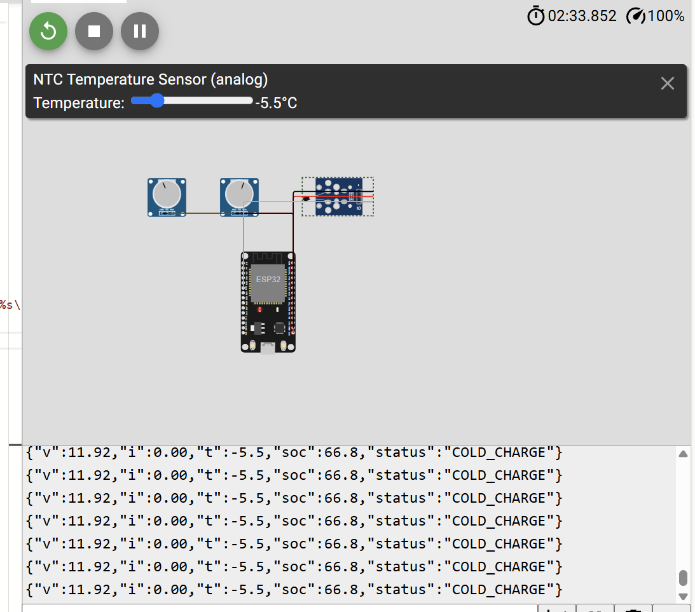

# 01 · Mini-BMS on ESP32

A simulated battery management system for a **4S LiFePO4 pack (12.8 V, 10 Ah)**, running on an ESP32 in [Wokwi](https://wokwi.com/projects/478383950468392961).

  

*Battery at −5.5 °C: the BMS reports `COLD_CHARGE`, forces the current to 0 A, and the SoC stops rising.*

## What it does

| Function | How |
|---|---|
| **Cell model** | Pack voltage computed from SoC: `V = N × (OCV(SoC) + I × R0)`, using an 11-point LiFePO4 OCV table and R0 = 8 mΩ per cell |
| **SoC estimation** | Coulomb counting: `SoC += I × Δt / capacity` |
| **Protection** | `OVERVOLTAGE` (> 14.4 V), `UNDERVOLTAGE` (< 10.5 V), `OVERTEMP` (> 45 °C), `COLD_CHARGE` (charging below 0 °C) |
| **Protection action** | Blocks charging and/or discharging depending on the fault, as a BMS opening its MOSFETs or contactor would |
| **Telemetry** | Publishes JSON every second over MQTT: `{"v":13.20,"i":0.00,"t":24.0,"soc":50.0,"status":"OK"}` |

| Fault | Charging blocked | Discharging blocked |
|---|:---:|:---:|
| OVERVOLTAGE | ✅ | |
| UNDERVOLTAGE | | ✅ |
| OVERTEMP | ✅ | ✅ |
| COLD_CHARGE | ✅ | |

## Simulated circuit

| Part | Pin | Role |
|---|---|---|
| Potentiometer (middle) | D35 | Pack current, −10 A (discharge) to +10 A (charge) |
| NTC temperature module | D32 | Pack temperature |
| Potentiometer (left) | D34 | Not used since the cell-model version (voltage is now calculated) |

Time runs 60× faster (1 s = 1 simulated minute), so SoC changes are visible.

## Design notes

- **Why Coulomb counting?** LiFePO4 voltage is almost flat between about 20% and 90% SoC (~3.25–3.36 V per cell), so voltage alone is a poor SoC estimate. Hitting a voltage limit is still useful to **recalibrate** SoC, because Coulomb counting drifts with sensor error.
- **Why block charging below 0 °C?** Charging lithium cells in the cold causes **lithium plating**, which permanently damages the cell. Discharging in the cold is allowed.
- **Checking the requested current:** the firmware checks whether the *requested* current would push the pack outside its limits before allowing it, similar in spirit to a state-of-power limit sent to a charger or inverter.

## Files

| File | Description |
|---|---|
| `sketch.ino` | Firmware (Arduino C++) |
| `diagram.json` | Wokwi circuit |
| `libraries.txt` | Wokwi libraries (`PubSubClient`) |

## Limitations

- Simulated sensors. The current sensor is a potentiometer standing in for an INA219/INA226.
- Typical LiFePO4 values, not a characterised cell. They can be replaced with parameters from a MATLAB/Simscape cell characterisation.
- No cell balancing or per-cell voltage monitoring (pack level only).
- The MQTT broker (`broker.hivemq.com`) is a public test broker. Fine for demo data, not for anything private.
