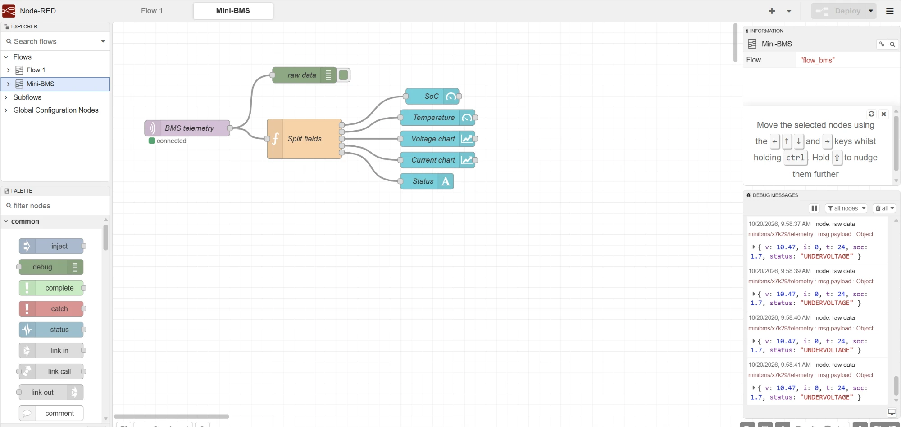

# 02 · IoT monitoring dashboard (MQTT + Node-RED)

Receives the ESP32 mini-BMS telemetry over MQTT and displays it live.

```
ESP32 (Wokwi) ──WiFi──► MQTT broker (broker.hivemq.com) ──► Node-RED ──► Dashboard
  publishes                 topic: minibms/x7k29/telemetry     subscribes
```

<p align="center">
  
</p>

## The flow

| Node | Role |
|---|---|
| **BMS telemetry** (mqtt in) | Subscribes to the topic and parses the JSON |
| **Split fields** (function) | Sends `soc`, `t`, `v`, `i` and `status` to separate widgets; adds 🟢 / 🔴 to the status |
| **SoC, Temperature** (gauges) | Live values with coloured ranges |
| **Voltage, Current** (charts) | 5-minute trends |
| **Status** (text) | Current BMS state: `OK`, `COLD_CHARGE`, `OVERVOLTAGE`… |
| **raw data** (debug) | Shows incoming messages in the editor |

## Run it

1. Install [Node.js](https://nodejs.org) (LTS), then Node-RED:
   ```bash
   npm install -g --unsafe-perm node-red
   node-red
   ```
2. Open `http://127.0.0.1:1880` → ☰ → **Manage palette** → install `@flowfuse/node-red-dashboard`
3. ☰ → **Import** → select `node-red-flow.json` → **Deploy**
4. Start the [Wokwi simulation](https://wokwi.com/projects/478383950468392961), then open `http://127.0.0.1:1880/dashboard`

## Notes

- The topic must match the one in `01-mini-bms-esp32/sketch.ino`. Change both to keep your data separate from other people using the same project.
- A public broker means anyone with the topic name can read or publish to it. For a real installation, use a private broker with TLS and authentication.
- In a real BESS, this role is filled by a **SCADA / energy management system**.
