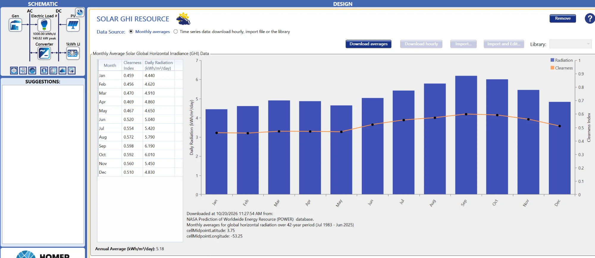
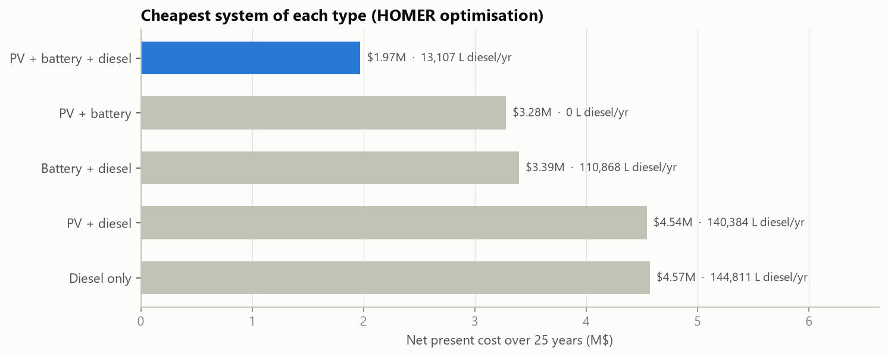
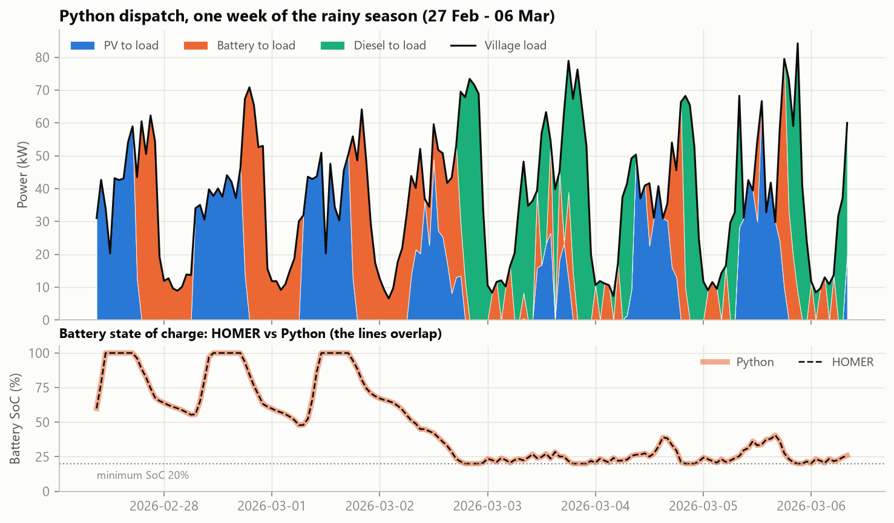
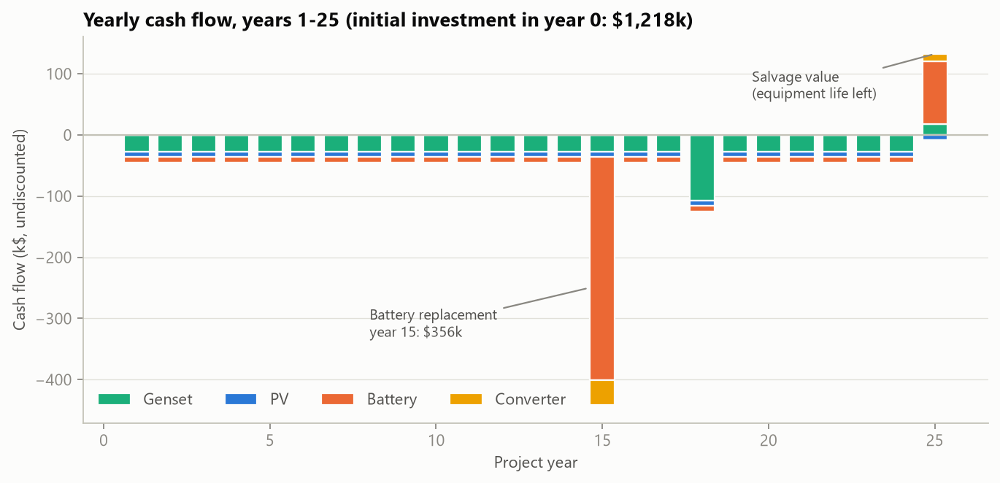
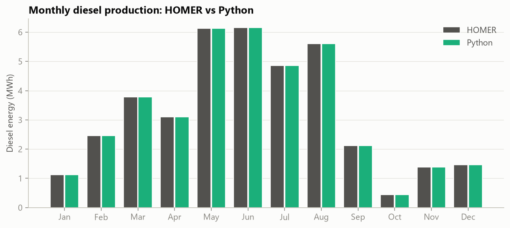

# 03 · Saül hybrid microgrid: HOMER Pro sizing + Python validation

Pre-feasibility sizing of a **PV + Li-ion battery + diesel** hybrid system for **Saül**, a village in central French Guiana that is reachable only by air and runs on an isolated diesel grid (*zone non interconnectée*, ZNI).

A December 2023 French decree ([n° 2023-1288](https://aida.ineris.fr/reglementation/decret-ndeg-2023-1288-261223-portant-modification-decret-ndeg-2017-457-30-mars-2017)) plans to replace Saül's diesel plant with a ~0.5 MW renewable + storage hybrid backed by a ~0.5 MW emergency generator. This study is an independent pre-sizing exercise, not that project's design.

## 1. Inputs and assumptions

| Item | Value | Note |
|---|---|---|
| Location | 3.62° N, 53.20° W | NASA POWER cell 3.75° N, 53.25° W |
| Load | **1,000 kWh/day**, peak 141 kW | ⚠️ **Synthetic** HOMER "Community" profile (evening peak, load factor 0.3). Real data not published. |
| Solar resource | **5.18 kWh/m²/day** | NASA POWER monthly averages, 1983–2025. Lowest in the rainy season (Jan–May), highest in Aug–Oct. |
| PV | $1,800/kW capital, $1,500 replacement, $25/kW/yr O&M, 25 yr, 80% derating | Remote-site premium |
| Battery (LFP) | $550/kWh capital, $400 replacement, $10/kWh/yr O&M, 15 yr, 3,000 kWh/kWh throughput, 90% round trip, 20% min SoC | HOMER idealized model, 1 kWh units |
| Converter | $400/kW, $350 replacement, $10/kW/yr, 15 yr, 95% | |
| Diesel genset | $600/kW, $500 replacement, $0.05/h/kW O&M, 15,000 h, 25% minimum load | Autosized |
| Diesel fuel | **$1.60/L** | Flown-in fuel |
| Economics | 8% discount rate, 2% inflation, 25 years | Real rate 5.88% |
| Dispatch | Load Following and Cycle Charging both tested | |

  

## 2. HOMER results

**Optimal system: 326 kW PV + 890 kWh battery + 114 kW converter + 160 kW diesel, Load Following**

| | Diesel only | **Optimal hybrid** | Change |
|---|---|---|---|
| Net present cost (25 yr) | $4.57M | **$1.97M** | −57% |
| LCOE | $0.969/kWh | **$0.418/kWh** | −57% |
| Diesel fuel | 144,811 L/yr | **13,107 L/yr** | −91% |
| Diesel running hours | 8,760 h/yr | **854 h/yr** | −90% |
| Renewable fraction | 0% | **89.4%** | |
| CO₂ (≈ 2.68 kg per litre) | ≈ 388 t/yr | ≈ 35 t/yr | ≈ −350 t/yr |

**PV and storage only work together:**

| System | Fuel saved vs diesel only |
|---|---|
| PV + diesel (no battery) | −3%: the diesel still runs 24/7 for reserve, and surplus PV is wasted |
| Battery + diesel (no PV) | −23%: the diesel runs at efficient load, then switches off |
| **PV + battery + diesel** | **−91%** |

The 100% renewable option (746 kW PV + 1,964 kWh battery) costs **$3.28M**: removing the last 11% of diesel adds about $1.3M, because the system would have to be sized for the cloudiest rainy-season weeks.

## 3. Independent Python validation

[`saul_analysis.py`](saul_analysis.py) **rebuilds HOMER's Load Following dispatch hour by hour** from the exported load and PV time series, then **rebuilds the 25-year cash flow**.

### Dispatch rules reproduced

1. PV supplies the load first (through the 95% inverter). Surplus charges the battery (√0.90 loss each way).
2. The battery covers the rest, down to 20% SoC.
3. **Operating reserve:** without the genset, PV + battery must cover the load + 10% **and** a sudden 80% drop in PV output. Otherwise the genset starts.
4. When running, the genset produces only what PV + battery cannot, but never below 25% load (40 kW). Surplus charges the battery through the rectifier.
5. Fuel = 4.67 L/h + 0.236 L/kWh.

### Results

| | HOMER | Python |
|---|---|---|
| Diesel hours | 854 | **854** (100% hourly agreement on/off) |
| Diesel energy | 38,629 kWh | 38,629 kWh |
| Fuel | 13,107 L | 13,105 L |
| Battery throughput | 180,344 kWh | 180,344 kWh |
| Excess electricity | 130,300 kWh | 130,300 kWh |
| Mean SoC difference | | 0.0 points |

### Economics check: the missing battery replacement

HOMER's cost summary and cash-flow chart show **no battery replacement**, although the battery's life is 15 years in a 25-year project. Rebuilding the cash flow both ways:

| NPC | Value | vs HOMER |
|---|---|---|
| HOMER (reported) | $1,970,691 | |
| Rebuilt, battery not replaced | $1,843,791 | −6.4% |
| **Rebuilt, battery replaced at year 15 ($356k)** | **$1,968,277** | **−0.1%** |

**Conclusion:** HOMER's NPC **does include** the battery replacement. Only its chart and summary table omit it.

## 4. Observations

- **79% of diesel hours run at the 40 kW minimum.** The genset mostly starts because the battery is near 20% at night or can't cover the reserve requirement on its own, not because of a large energy deficit.
- **Diesel use peaks from May to August:** rainy-season solar combined with the mid-year load peak.
- **26% of PV output (130 MWh/yr) is surplus.** Candidates for flexible loads: water pumping, ice production, EV charging.

## Files

| File | Description |
|---|---|
| `homer/Saul_Hybrid.homer` | HOMER Pro 3.18 project |
| `data/homer_hourly_optimal.csv` | HOMER hourly export of the optimal system (8,760 h) |
| `data/homer_optimisation_results.csv` | All systems evaluated by the optimiser |
| `saul_analysis.py` | Dispatch + economics rebuild, charts |
| `output/` | Charts and comparison tables (generated) |

## Limitations

- Synthetic load: the results are only as good as this assumption, and a measured profile would change the sizing.
- Monthly-average solar data (HOMER synthesises the hourly values). No temperature derating of PV.
- Idealized battery model (energy-based, no voltage or degradation curve).
- No sensitivity analysis yet (fuel price, battery cost, reserve settings).
