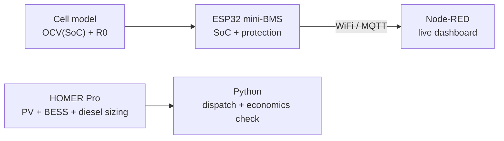
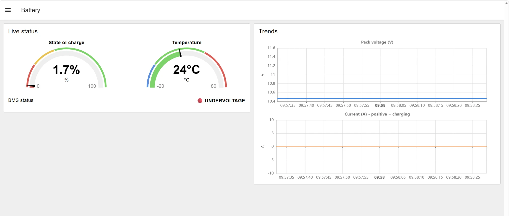

# Battery Storage for Isolated Grids: from BMS to Microgrid Sizing

A learning project that follows a battery energy storage system (BESS) from the cell to the grid:

1. **Mini-BMS on ESP32**: cell model, state-of-charge estimation and protection logic (simulated in Wokwi)
2. **IoT monitoring**: live telemetry over MQTT to a Node-RED dashboard
3. **Microgrid sizing**: PV + battery + diesel hybrid for Saül, an isolated village in French Guiana, optimised in HOMER Pro and **independently rebuilt in Python**



> All parts are **simulations and pre-feasibility studies**, not field installations. Assumptions are listed in each section.

---

## Key results

| Part | Result |
|---|---|
| **Mini-BMS** | Coulomb-counting SoC with 4 protections (over/under-voltage, over-temperature, charge blocking below 0 °C) that actually open the current path |
| **IoT** | ESP32 → MQTT → Node-RED dashboard with SoC and temperature gauges, voltage/current trends and a live fault indicator |
| **Saül microgrid** | **326 kW PV + 890 kWh LFP battery + 160 kW diesel backup**: 89% renewable, **−91% diesel fuel**, NPC **$1.97M vs $4.57M** for diesel only (−57%) |
| **Python check** | Rebuilt HOMER's Load Following dispatch hour by hour: **854 / 854 diesel hours, identical SoC, NPC within 0.1%** |

<p align="center">
  
</p>

---

## Repository structure

| Folder | Content |
|---|---|
| [`01-mini-bms-esp32/`](01-mini-bms-esp32/) | ESP32 firmware (Arduino C++), Wokwi circuit, [run it online](https://wokwi.com/projects/478383950468392961) |
| [`02-iot-dashboard/`](02-iot-dashboard/) | Node-RED flow (MQTT subscriber + FlowFuse Dashboard 2.0) |
| [`03-saul-microgrid/`](03-saul-microgrid/) | HOMER Pro model and exports, Python validation script, charts |
| `docs/images/` | Screenshots used in the READMEs |

---

## Skills demonstrated

- **Battery modelling**: equivalent-circuit cell model (OCV–SoC table + internal resistance), LiFePO4 behaviour (flat voltage plateau, cold-charging limits)
- **Embedded / BMS logic**: Coulomb counting, protection state machine, charge/discharge blocking
- **IoT**: WiFi, MQTT publish/subscribe, JSON telemetry, Node-RED dashboards
- **Energy system design**: HOMER Pro optimisation, load and solar resource modelling, dispatch strategies (Load Following vs Cycle Charging)
- **Techno-economics**: NPC, LCOE, replacement and salvage values, real discount rate
- **Python**: pandas time-series analysis, a rebuilt dispatch model, matplotlib charts
- **Verification**: cross-checking software results by hand and in code. The Python rebuild found that HOMER's cash-flow chart leaves out the year-15 battery replacement, even though its NPC includes it.

---

## How to run

**Mini-BMS + dashboard**
1. Open the [Wokwi project](https://wokwi.com/projects/478383950468392961) and press ▶. No hardware is needed.
2. Install [Node.js](https://nodejs.org) and Node-RED (`npm install -g --unsafe-perm node-red`), add `@flowfuse/node-red-dashboard` from *Manage palette*, then import [`02-iot-dashboard/node-red-flow.json`](02-iot-dashboard/node-red-flow.json)
3. Open `http://127.0.0.1:1880/dashboard`

**Microgrid analysis**
```bash
cd 03-saul-microgrid
pip install -r requirements.txt
python saul_analysis.py
```

---

## Limitations and next steps

- The village load is **synthetic** (HOMER "Community" profile scaled to 1,000 kWh/day). Saül's real consumption isn't published.
- Costs are **assumptions** for a remote site reachable only by air (see the microgrid README).
- The BMS runs on simulated sensors. Next: real hardware (ESP32 + INA219 + DS18B20) and an extended Kalman filter for SoC.
- The BMS demo pack and the HOMER battery use different operating windows (voltage limit vs 20% minimum SoC). Next: add a SoC-based limit to the firmware.
- Sensitivity analysis: fuel price, battery cost and HOMER's PV operating reserve (80%), which drives much of the remaining diesel use.

---

## Résumé en français

Projet d'apprentissage sur le stockage d'énergie par batterie, de la cellule au réseau :
**(1)** mini-BMS simulé sur ESP32 (modèle de cellule, estimation du SoC par comptage coulombmétrique, protections dont le blocage de la charge sous 0 °C) ;
**(2)** supervision en temps réel via MQTT et Node-RED ;
**(3)** pré-dimensionnement d'une centrale hybride PV + stockage + groupe électrogène pour **Saül (Guyane, zone non interconnectée)** avec HOMER Pro, puis vérification indépendante en Python.
Résultat : 89 % d'énergies renouvelables, **−91 % de consommation de gazole** et un coût actualisé divisé par plus de deux par rapport au tout-diesel.

---

**Author:** Dauemi Roy · [LinkedIn](https://www.linkedin.com/in/dauemi-roy-44848042b/) · Open to a 6-month end-of-studies internship (*stage de fin d'études*) from April 2027 in battery storage, smart grids and energy systems.
